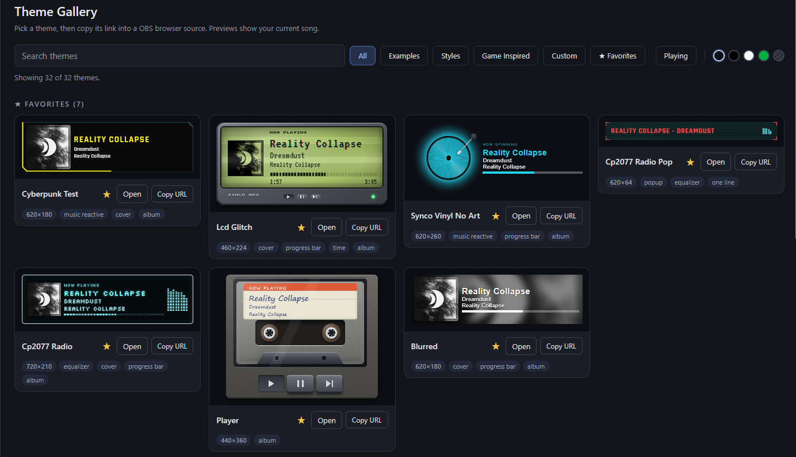
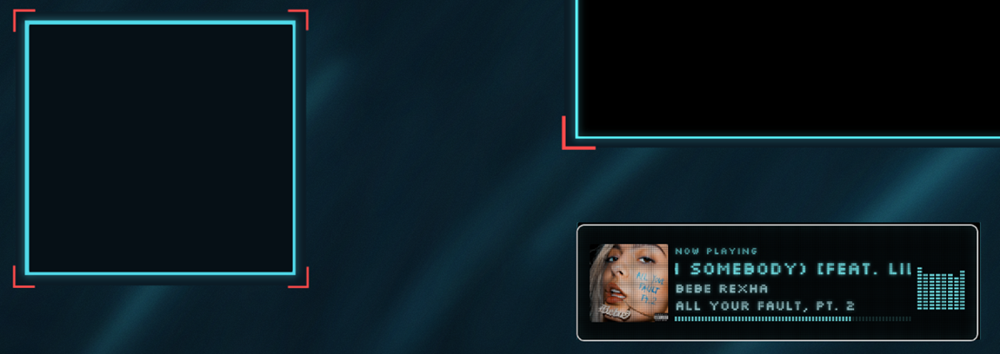
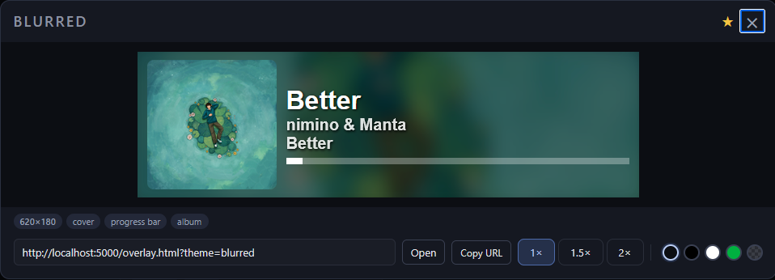
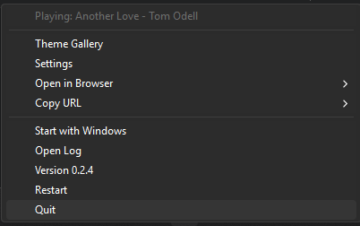

# Now Playing Overlay

A small Windows app that shows what's playing in **Apple Music** or **Spotify** as an overlay for OBS or Twitch streams. It runs in the system tray, 
serves the overlay as a local web page, and ships with themes, an audio equalizer, a progress bar, and a popup mode.

**[Download the latest version](https://github.com/S7nco/nowplaying/releases/latest)**
(get the file named `NowPlaying-....zip` under **Assets**, not **Source Code**)




## Features

- Song title, artist, album, cover art, and a progress bar with optional elapsed / total time
- Works with the Apple Music app for Windows and the Spotify desktop app, and follows whichever one is playing
- Live equalizer and music-reactive glows, driven by the player's audio
- Popup mode: appears when the song changes, then fades out
- A Theme Gallery to preview every theme, with search, filters, favorites and test backgrounds. Click a theme to see it bigger, with the exact OBS size
- Themes are plain CSS files. Examples are included, and you can make your own ([how to make a theme](THEMES.md))
- Runs quietly in the system tray, with a status line showing the current song
- Written in Rust. Uses a few MB of memory and almost no CPU

## Requirements

- Windows 10 or 11
- The Apple Music app for Windows, or the Spotify desktop app
- OBS Studio (or any program that can show a web page)

## Quick Start

1. Download `NowPlaying-...zip` from the [latest release](https://github.com/S7nco/nowplaying/releases/latest) and unzip it anywhere.
   - To check the download, compare `Get-FileHash NowPlaying-....zip` (in PowerShell) with the code in the `.sha256` file next to the zip on the release page. They should match.
2. Run `nowplaying.exe`. An icon appears in the system tray.
3. Start playing something in Apple Music or Spotify.
4. In OBS, add a Browser source with:
   - URL: `http://localhost:5000/overlay.html`
   - Width: 620, Height: 180



To try another theme, change the address, for example, `http://localhost:5000/overlay.html?theme=eq`. You can also right-click the tray icon and use **Open in Browser** or **Copy URL**.

Windows may warn you ("Windows protected your PC") because the app is not code-signed. Choose **More info > Run anyway**. To avoid the warning, right-click the zip before unzipping it, choose **Properties**, tick **Unblock**, and click **OK**. The full source is in this repository. 

To start the app with Windows, press Win+R, type `shell:startup`, and put a shortcut to `nowplaying.exe` in the folder that opens.

### Updating

Quit the app from the tray, then unzip the new release to the same place as before, so its `NowPlaying` folder lands on top of your old one. Choose **Replace** when Windows asks. Your `config.toml`, `favorites.json` and custom themes are not in the zip, so they stay as they are.

If you unzip into a new folder instead, copy `config.toml`, `favorites.json` and `static\themes\custom` over from the old one. If you forget `favorites.json`, open the Theme Gallery once and it copies the stars saved in your browser back into the app.

### Spotify

In Spotify, open Settings and turn on **Show desktop overlay when using media keys**. Spotify only tells Windows what it is playing when this is on.

## Theme Gallery

Open `http://localhost:5000/gallery.html`, or left-click the tray icon, to see every theme running.

- Search and filter themes by group
- Click **Open** to open a theme, or **Copy URL** to paste it into OBS
- Click a preview to enlarge it. The enlarged view shows the theme's OBS browser source size, its URL, and a scale control (1x, 1.5x, 2x) that updates both. Popup themes get a **Replay popup** button
- Each card shows the theme's OBS size (width x height), including any room it needs for glows
- Link straight to a theme with `gallery.html#name`, e.g. `http://localhost:5000/gallery.html#neon`
- Click the star on a theme to add it to your **Favorites**, which appear at the top of the page
- Use the colored dots to preview themes on a dark, black, white, green, or checkered background (useful for transparent themes)
- Use **Playing / Paused** to freeze the previews

Your favorites also appear in the tray menu, under **Open in Browser** and **Copy URL**. They are saved in `favorites.json` next to the app. Until you star something, the tray uses the `tray_themes` list from `config.toml`.



## The tray menu

Left-click the tray icon to open the Theme Gallery. Right-click it for the menu:



| Item | What it does |
|---|---|
| Status line | Shows the current song and whether it is playing or paused. Reads "No Song Detected" when a player is open but idle, and "Application Not Running" when none is open |
| Theme Gallery | Opens the Theme Gallery in your browser |
| Open in Browser | Opens the overlay in one of your favorite themes |
| Copy URL | Copies the overlay address for one of your favorite themes |
| Copy Network URL | Only when `bind_address` lets other devices connect. Copies the overlay address with this PC's network address, for OBS on another computer | 
| Open Log | Opens `nowplaying.log`, which helps when something isn't working |
| Version | Shows which version you're running. Click it to see the releases page | 
| Restart | Restarts the app. Needed after changing `port` or `bind_address` |
| Quit | Closes the app. |

Hover over the icon to see the current song.

## URL Options

Add these to the overlay address, for example `http://localhost:5000/overlay.html?theme=eq&scale=1.5`. Combine options with `&`.

| Option | What it does | Example |
|---|---|---|
| `theme` | Picks a theme from any folder in `static/themes` | `?theme=eq` |
| `bg` | Page background color, for testing in a browser. A normal browser shows black by default. OBS is always transparent. | `?bg=gray` |
| `scale` | Makes the whole overlay bigger or smaller | `?scale=1.5` | 

### Choosing a scale
At normal size, the default overlay is 620 x 180 pixels. When you change the scale, set the OBS browser source width and height to match, or the overlay will be cut off or leave empty space.

The easiest way to get the right size for any theme: open it in the Theme Gallery and click its preview. The enlarged view shows the exact browser source size at each scale.

| Scale | Browser Source Size | Good For |
|---|---|---|
| 1 | 620 x 180 | 1080p streams |
| 1.5 | 930 x 270 | 1440p, or a larger overlay on 1080p | 
| 2 | 1240 x 360 | 4K |

Some themes use their own size (set with `--overlay-width` and `--overlay-height`). For those, multiply that theme's size by the scale. Using `scale` is sharper than stretching the source in OBS, because the text is redrawn at the new size.

Themes with glows may also add empty space around the overlay (`--offset`). Make the browser source bigger by that amount on each side, or the glow gets cut off.

## Themes

Themes are CSS files:

- `static/themes/examples/` holds the example themes. Each one shows off a single feature (equalizer, popup mode, time display, blurred cover background, artwork size, and so on).
- `static/themes/styles/` holds finished styles.
- `static/themes/game-inspired/` holds themes inspired by games.
- `static/themes/custom/` is for your own themes. Name the file with letters, numbers, `-` and `_` only, e.g. `my-theme.css`. 

To make a new group, add a folder in `static/themes/` (same naming rule as theme files, e.g. `retro-games`). It shows up in the Theme Gallery as its own section and filter after you refresh the page. No code changes needed.

If two themes have the same name, the first one found is used: custom first, examples last, and the other folders in alphabetical order. Every setting a theme can change, with its default, is listed in [THEMES.md](THEMES.md).

A new theme file shows up in the Theme Gallery after you refresh the page. Star it there to add it to the tray menu. Editing an existing theme only needs a page refresh (in OBS: right-click the browser source and choose **Refresh the cache of current page**).

## Configuration

Copy `config.example.toml` to `config.toml` (next to `nowplaying.exe`) to change settings. Every setting is optional. Changes are picked up within a couple of seconds while the app runs. `port` and `bind_address` need a **Restart** from the tray menu.

| Setting | Default | What it does |
|---|---|---|
| `port` | 5000 | Port the overlay server uses | 
| `bind_address` | `"127.0.0.1"` | Who can connect: `"127.0.0.1"` is this PC only. `"0.0.0.0"` lets other devices on your network connect (see Network Note) | 
| `allowed_hosts` | `[]` | Extra names the overlay can be opened by from other devices. IP addresses and this PC's own name always work (see Network Note) |
| `process_name` | `"AmpLibraryAgent.exe, Spotify.exe"` | The players' process names, used to capture audio for the equalizer | 
| `app_id_match` | `"applemusic, spotify"` | Part of the player's Windows media ID, used to find the right player |
| `tray_themes` | `["default"]` | Themes shown in the tray menu until you pick favorites in the gallery | 
| `eq_floor_db` | `-73.0` | Equalizer level shown as an empty bar (see below) |
|`eq_ceil_db` | `-27.0` | Equalizer level shown as a full bar (see below) |
| `eq_tilt_db` | `3.0` | How much each higher band is boosted (see below) |

`process_name` and `app_id_match` take a comma-separated list, matched by position: the first entry in each belongs to the first player, the second to the second player, and so on. The overlay follows the player that is playing.

## Tuning the equalizer

Different music and volume settings can make the bars look too full or too flat. Adjust these in `config.toml` and save; the bars change within a couple of seconds. They depend on the volume inside the player app, not the Windows volume.

| What you see | What to change |
|---|---|
| Bars always at the top or bouncing at the max | Raise `eq_ceil_db` (less negative, e.g. `-27` to `-22`) |
| Bars barely moving | Lower `eq_ceil_db` (more negative) or lower `eq_floor_db` |
| Bars stay up when the music is quiet | Raise `eq_floor_db` (less negative) | 
| Right-hand bars too weak compared to the left | Raise `eq_tilt_db` |
| Left-hand bars too weak compared to the right | Lower `eq_tilt_db` |

Change one value at a time, by about 5 for the floor and ceiling and by about 0.5 for the tilt.

## Troubleshooting
- **The overlay is blank.** Check that a player is playing, and look at the tray status line to see what the app detects.
- **Spotify isn't detected.** In Spotify, turn on **Show desktop overlay when using media keys**, then restart Spotify. Make sure it's the desktop app, since the web player in a browser shows up under the browser's name.
- **The equalizer doesn't move.** Check that `process_name` in `config.toml` matches the players' process name in Task Manager (Details tab). Restart the app after the player updates.
- **The port is already in use.** Another program is using port 5000. Change the `port` in `config.toml`.
- **A new theme isn't showing.** Refresh the Theme Gallery page. Check the file name uses only letters, numbers, `-` and `_`, and that Windows isn't hiding the extension and naming it `mytheme.css.txt`. Skipped themes are listed in `nowplaying.log`.
- **The overlay doesn't load from another PC or phone.** Set `bind_address = "0.0.0.0"` in `config.toml`, restart the app, and use the PC's network address (see Network Note) instead of `localhost`.
- **Something else is wrong.** Look at `nowplaying.log` next to the exe. If the app closed by itself, the previous run's log is in `nowplaying.old.log`.

## Reporting problems and ideas

Open an [issue](https://github.com/S7nco/nowplaying/issues) with your app version (shown in the tray menu; 0.2.0 and later), your Windows version, which player you use and the contents of `nowplaying.log` (tray menu -> **Open Log**). Feature ideas are welcome there too. 

The log doesn't include your Windows user name or what you listen to, but have a look through it before posting.

## Privacy

Now Playing runs entirely on your PC. It doesn't send anything to the internet: no statistics, no tracking, and no update checks (the **Version** item in the tray menu only opens the releases page when you click it).

**What it reads**
- The song that's playing (title, artist, album, cover, position), from Windows' media controls, the same information Windows shows in its volume popup.
- The audio of your music player only, to drive the equalizer. It's analysed as it plays and never saved or sent anywhere.

**What it saves**, next to `nowplaying.exe`
- `config.toml`: your settings
- `favorites.json`: your favorite themes
- `nowplaying.log` and `nowplaying.old.log`: what the app did. They don't contain your Windows user name or song titles, but check them before posting them anywhere.
- `static\cover.jpg`: the current song's cover, for the overlay

The Theme Gallery also remembers your favorites and preview background in your browser.

**Who can connect.** By default, only this PC. Other websites open in your browser can't read what you're playing or change anything. With `bind_address = "0.0.0.0"`, other devices on your network can view the overlay and gallery, but only this PC can change anything (see Network Note).

Themes can load fonts or images from the internet if their CSS says so. The included themes don't (check before using a theme from someone else; see [THEMES.md](THEMES.md)).

## Network Note

By default the overlay server only accepts connections from the same PC (`bind_address = "127.0.0.1"`), so nothing else on your network can reach it. If OBS runs on another computer (a second streaming PC), or you want to open the gallery from a phone, add this to `config.toml` and restart the app: 
```
bind_address = "0.0.0.0"
```

Then right-click the tray icon and use **Copy Network URL**: it copies the overlay address with your PC's network address instead of `localhost`, ready to paste into OBS on another computer. To type it yourself, run `ipconfig` in the terminal and look for **IPv4 Address** to find it, e.g. `http://192.168.1.21:5000/overlay.html`. Windows may ask to allow network access the first time: allow **Private networks**. The app does not send any data to the internet.

You can also use the PC's name instead of its address, e.g. `http://DESKTOP-ABC:5000/overlay.html`. If your network adds something to the name (like `desktop-abc.lan`), add it to `allowed_hosts` in `config.toml`.

## Building from Source

You need [Rust](https://rustup.rs) (a recent version: the project uses the 2024 edition, so Rust 1.85 or newer). Then:

```
cargo build --release
```

The program is created at `target\release\nowplaying.exe`. It needs the `static` folder and `icon.ico`, and finds them in the project folder. To make a release zip yourself run `package.ps1`.

## Credit and License

Fonts included in `static/fonts` are licensed under the SIL Open Font License. Each font's license is in its own folder.

The themes in `static/themes/game-inspired` are original CSS made to echo the look of games. They are not affiliated with or endorsed by any game or publisher, and they use no logos or artwork from those games.

This project is licensed under the MIT License. See [LICENSE](LICENSE). 
